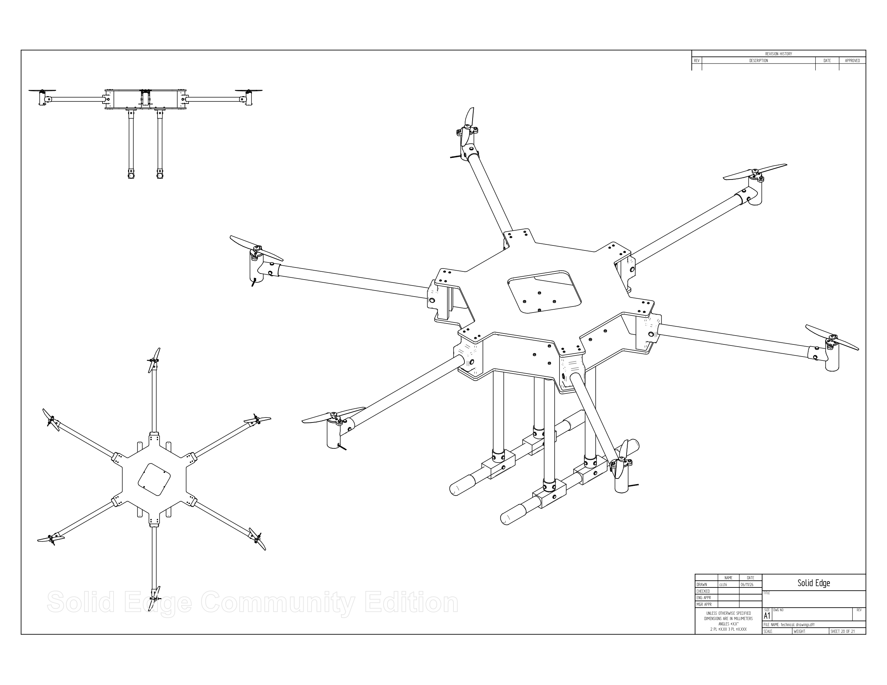
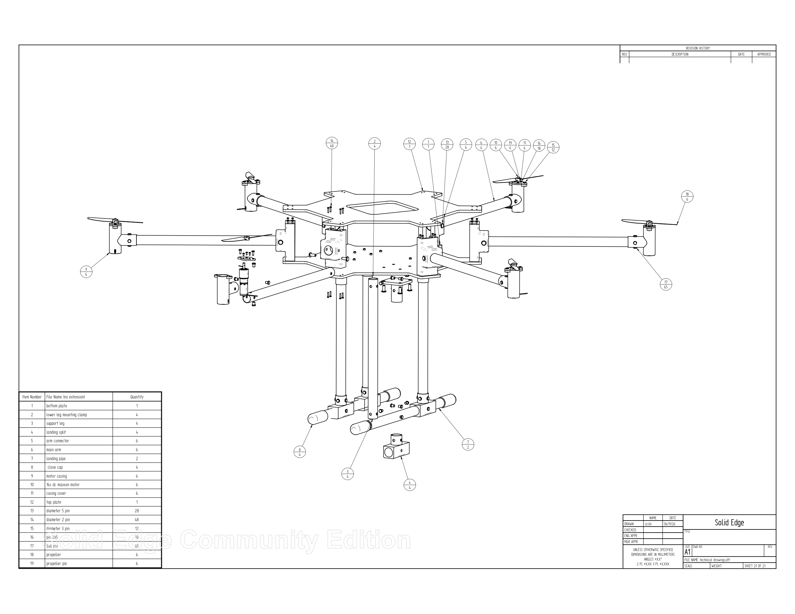
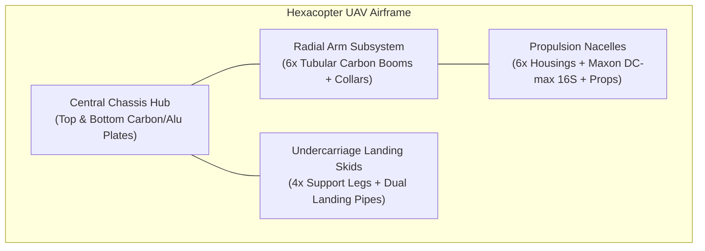

# Hexacopter-CAD: Parametric 3D CAD Model & Technical Manufacturing Drawings for a Custom UAV Airframe

[](https://solidedge.siemens.com/)
[](#)
[](#)
[](LICENSE)
[](https://github.com/sbbxiii)

---

## 1. Executive Summary

**Hexacopter-CAD** is an engineered parametric 3D CAD model and complete technical drafting package for a modular, heavy-lift hexacopter Unmanned Aerial Vehicle (UAV). Designed from first principles in **Siemens Solid Edge**, this repository provides native CAD assembly models (`.asm`), parametric part models (`.par`), comprehensive 2D manufacturing blueprints (`.dft` / PDF), and production-ready additive manufacturing meshes (`.stl`).

The airframe is designed around a 6-rotor radial symmetry layout, providing inherent thrust redundancy, high payload stability, and optimized motor nacelles specifically tailored for **Maxon DC-max 16 S** high-precision DC drives.

---

## 2. Airframe Assembly & Exploded Visualizations

### Fully Assembled Airframe Architecture

*Sheet 20: General arrangement drawing illustrating isometric, top, front, and side orthographic projections of the assembled UAV airframe.*

### Exploded Callout Assembly & Bill of Materials

*Sheet 21: Exploded assembly drawing detailing component indexing, hardware fasteners, structural pins, and subassembly breakdown.*

---

## 3. Structural Subsystems & Engineering Rationale

The airframe consists of four primary mechanical subsystems:



### 1. Central Chassis Hub (Sandwich Architecture)
* **Top & Bottom Plates (`Item 1 & 12`):** Symmetrical hexagonal geometry with a central rectangular access aperture for battery cabling, avionics mounting, and power distribution boards.
* **Modular Arm Mounts:** Six peripheral clamping interfaces evenly distributed at $60^\circ$ radial increments, transferring aerodynamic motor thrust into the rigid central core without flexure.

### 2. Radial Propulsion Arms & Arm Clamps
* **Main Arms (`Item 6`):** Lightweight tubular structural spars designed to resist high torsional moments induced by motor torque.
* **Arm Connectors (`Item 5`):** High-load collar mounts providing positive mechanical interlock with the central sandwich plates using dowel pins and through-bolts.

### 3. Motor Housings & Propulsion Integration
* **Custom Motor Nacelles (`Item 9 & 11`):** Two-part modular nacelles engineered with internal locating ribs to securely clamp **Maxon DC-max 16 S (24V)** coreless DC motors.
* **Propeller Hub Retainers (`Item 18 & 19`):** Dual-blade aerodynamic propellers secured by dedicated retaining pins to eliminate hub slip during rapid angular acceleration.

### 4. High-Clearance Undercarriage Landing Gear
* **Vertical Support Legs (`Item 3`):** Four vertical tubular stanchions clamped directly beneath the lower chassis plate via mounting collars (`Item 2`).
* **Dual Skid Pipes (`Item 7`):** Longitudinal landing tubes connected via split-truss brackets (`Item 4`) to distribute impact forces during landing.
* **Damper End Caps (`Item 8`):** Soft, slip-on caps protecting the pipe ends and providing anti-abrasion ground damping.

---

## 4. Complete Bill of Materials (BOM)

Every part has a dedicated parametric Solid Edge CAD file (`.par`), an exported 3D printing mesh (`.stl`), and a formal engineering drawing (`.pdf`):

| Item | Component Name | Qty | 2D Drawing Blueprint | 3D CAD Model | Production Mesh | Suggested Material / Spec |
| :---: | :--- | :---: | :---: | :---: | :---: | :--- |
| **1** | **Bottom Plate** | 1 | [1.pdf](manufacturing/drawings/1.pdf) | [bottom plate.par](cad/parts/bottom%20plate.par) | [bottom plate.stl](manufacturing/stl/bottom%20plate.stl) | 2.5 mm Carbon Fiber / 6061-T6 Aluminum |
| **2** | **Lower Leg Mounting Clamp** | 4 | [2.pdf](manufacturing/drawings/2.pdf) | [lower leg mounting clamp.par](cad/parts/lower%20leg%20mounting%20clamp.par) | [lower leg mounting clamp.stl](manufacturing/stl/lower%20leg%20mounting%20clamp.stl) | PETG / CNC Aluminum |
| **3** | **Support Leg** | 4 | [3.pdf](manufacturing/drawings/3.pdf) | [support leg.par](cad/parts/support%20leg.par) | [support leg.stl](manufacturing/stl/support%20leg.stl) | Carbon Fiber Tube ($\varnothing 12\text{ mm}$) |
| **4** | **Landing Split** | 4 | [4.pdf](manufacturing/drawings/4.pdf) | [landing split.par](cad/parts/landing%20split.par) | [landing split.stl](manufacturing/stl/landing%20split.stl) | High-Strength PETG / Nylon PA12 |
| **5** | **Arm Connector** | 6 | [5.pdf](manufacturing/drawings/5.pdf) | [arm connector.par](cad/parts/arm%20connector.par) | [arm connector.stl](manufacturing/stl/arm%20connector.stl) | PETG / CNC 6061 Aluminum |
| **6** | **Main Arm** | 6 | [6.pdf](manufacturing/drawings/6.pdf) | [main arm.par](cad/parts/main%20arm.par) | [main arm.stl](manufacturing/stl/main%20arm.stl) | Structural Carbon Fiber Tube |
| **7** | **Landing Pipe** | 2 | [7.pdf](manufacturing/drawings/7.pdf) | [landing pipe.par](cad/parts/landing%20pipe.par) | [landing pipe.stl](manufacturing/stl/landing%20pipe.stl) | Aluminum / Carbon Skid Tube |
| **8** | **Close Cap** | 4 | [8.pdf](manufacturing/drawings/8.pdf) | [close cap.par](cad/parts/%20close%20cap%20.par) | [close cap.stl](manufacturing/stl/%20close%20cap%20.stl) | TPU 95A / Rubber |
| **9** | **Motor Casing** | 6 | [9.pdf](manufacturing/drawings/9.pdf) | [motor casing.par](cad/parts/motor%20casing%20.par) | [motor casing.stl](manufacturing/stl/motor%20casing%20.stl) | High-Temp ASA / PETG / Nylon |
| **10** | **16S DC Maxon Motor** | 6 | [10.pdf](manufacturing/drawings/10.pdf) | [16s dc maxxon motor.par](cad/parts/16s%20dc%20maxxon%20motor.par) | [16s dc maxxon motor.stl](manufacturing/stl/16s%20dc%20maxxon%20motor.stl) | Maxon DC-max 16 S (24V) |
| **11** | **Casing Cover** | 6 | [11.pdf](manufacturing/drawings/11.pdf) | [casing cover.par](cad/parts/casing%20cover.par) | [casing cover.stl](manufacturing/stl/casing%20cover.stl) | PETG / ABS |
| **12** | **Top Plate** | 1 | [12.pdf](manufacturing/drawings/12.pdf) | [top plate.par](cad/parts/top%20plate.par) | [top plate.stl](manufacturing/stl/top%20plate.stl) | 2.5 mm Carbon Fiber / 6061-T6 Aluminum |
| **13** | **Diameter 5 Pin** | 28 | [13.pdf](manufacturing/drawings/13.pdf) | [diameter 5 pin.par](cad/parts/diameter%205%20pin.par) | [diameter 5 pin.stl](manufacturing/stl/diameter%205%20pin.stl) | $\varnothing 5\text{ mm}$ Stainless Steel Dowel Pin |
| **14** | **Diameter 2 Pin** | 48 | [14.pdf](manufacturing/drawings/14.pdf) | [diameter 2 pin.par](cad/parts/diameter%202%20pin.par) | [diameter 2 pin.stl](manufacturing/stl/diameter%202%20pin.stl) | $\varnothing 2\text{ mm}$ Stainless Steel Dowel Pin |
| **15** | **Diameter 3 Pin** | 12 | [15.pdf](manufacturing/drawings/15.pdf) | [diameter 3 pin.par](cad/parts/diameter%203%20pin.par) | [diameter 3 pin.stl](manufacturing/stl/diameter%203%20pin.stl) | $\varnothing 3\text{ mm}$ Stainless Steel Dowel Pin |
| **16** | **Pin 2x5** | 18 | [16.pdf](manufacturing/drawings/16.pdf) | [pin 2x5.par](cad/parts/pin%202x5.par) | [pin 2x5.stl](manufacturing/stl/pin%202x5.stl) | $2\times 5\text{ mm}$ Dowel Pin |
| **17** | **5x6 Pin** | 65 | [17.pdf](manufacturing/drawings/17.pdf) | [5x6 pin.par](cad/parts/5x6%20pin.par) | [5x6 pin.stl](manufacturing/stl/5x6%20pin.stl) | $5\times 6\text{ mm}$ Dowel Pin |
| **18** | **Propeller** | 6 | [18.pdf](manufacturing/drawings/18.pdf) | [propeller.par](cad/parts/propeller.par) | [propeller.stl](manufacturing/stl/propeller.stl) | Carbon-Reinforced Polymer |
| **19** | **Propeller Pin** | 6 | [19.pdf](manufacturing/drawings/19.pdf) | [propeller pin.par](cad/parts/propeller%20pin.par) | [propeller pin.stl](manufacturing/stl/propeller%20pin.stl) | Hardened Steel Retaining Pin |

*The complete CSV version is available in [`manufacturing/BOM.csv`](manufacturing/BOM.csv).*

---

## 5. Additive Manufacturing & Fabrication Guidelines

For prototyping or low-volume fabrication using FDM or SLS 3D printing:

| Subassembly | Recommended Material | Layer Height | Infill | Perimeters / Walls | Notes |
| :--- | :--- | :---: | :---: | :---: | :--- |
| **Arm Connectors & Mounts** | PETG / Carbon Fiber PETG | 0.16–0.20 mm | 50% Gyroid | $\ge 4$ Walls | High shear resistance required |
| **Motor Nacelles & Covers** | ASA or Polycarbonate (PC) | 0.16 mm | 40% Grid | $\ge 4$ Walls | Heat deflection near motors |
| **Landing Split Brackets** | PETG / ABS | 0.20 mm | 45% Triangular | $\ge 4$ Walls | Impact absorption during touchdown |
| **End Caps** | TPU 95A / 85A | 0.20 mm | 20% Gyroid | 3 Walls | Flexible damping |
| **Plates (CNC Alternative)** | 3K Twill Matte Carbon Fiber | N/A (Milled) | 100% Solid | N/A | CNC router cut from 2.5 mm sheet |

---

## 6. Repository Structure

```
Hexacopter-CAD/
├── cad/
│   ├── assembly/
│   │   ├── assembly view of drone.asm   # Main Solid Edge 3D assembly
│   │   ├── assembly view of drone.cfg   # Assembly display configuration
│   │   └── technical drawings.dft       # Full drafting sheet package
│   └── parts/                           # 19 Parametric Solid Edge part models (.par)
├── manufacturing/
│   ├── drawings/                        # 2D PDF blueprints (1.pdf - 19.pdf, Assembly, Exploded)
│   ├── stl/                             # 19 Production 3D STL meshes
│   └── BOM.csv                          # Structured component Bill of Materials
├── docs/
│   └── images/
│       ├── assembly_drawing.png         # High-resolution 2500px assembly render
│       └── exploded_view.png            # High-resolution 2500px exploded callout render
├── .gitignore
├── LICENSE
└── README.md
```

---

## 7. Author & License

* **Designed & Engineered by:** Osakwe Nmesoma Chukwukadibia ([@sbbxiii](https://github.com/sbbxiii))
* **License:** [MIT License](LICENSE)
